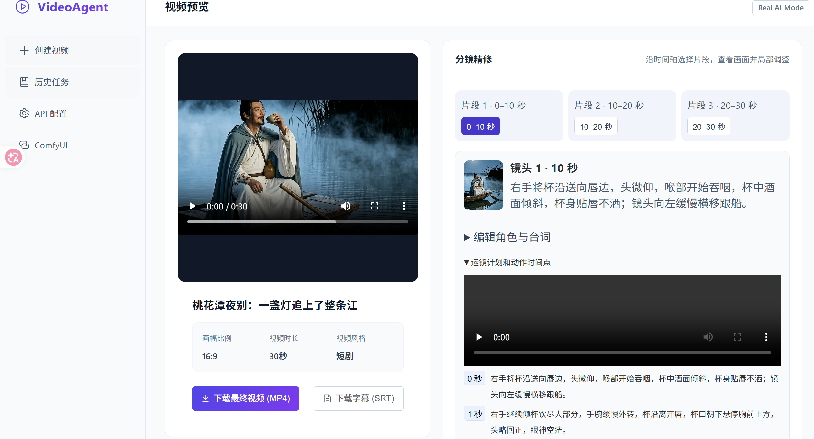
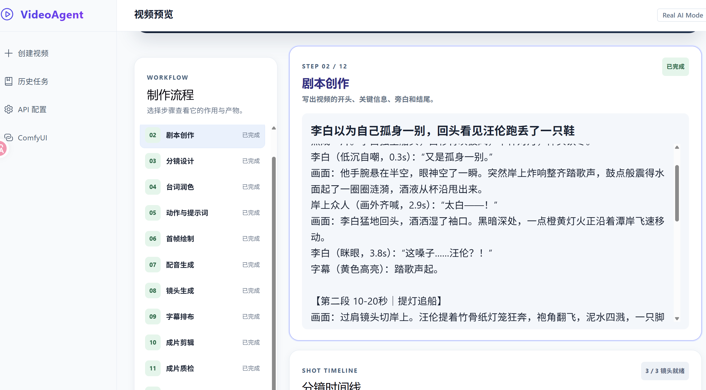

# VideoAgent

VideoAgent 把一句故事梗概做成带画面、配音和字幕的短片。你可以查看剧本、分镜和逐秒动作计划，在预览页精修单个镜头，再下载 MP4 和 SRT。

## 项目演示

### 成片预览与分镜精修



《桃花潭夜别》使用三个 10 秒片段。预览页可以按时间段查看首帧、台词、运镜和动作，并单独调整镜头。

### 查看制作过程



制作流程展示各阶段的状态和产物，可以沿着剧本、分镜、首帧、配音和镜头生成追查成片效果。

## 快速开始

准备 Python 3.13、Node.js 22.12 或更高版本、MongoDB 和 FFmpeg。启动 MongoDB 后，项目默认连接 `mongodb://localhost:27017`，使用 `video_agent` 数据库。

在项目根目录打开 PowerShell，启动后端。

```powershell
cd backend
python -m pip install -r requirements.txt
Copy-Item .env.example .env
python -m uvicorn main:app --host 127.0.0.1 --port 8000
```

在另一个终端从项目根目录启动前端。

```powershell
cd frontend
npm ci
npm run dev
```

打开 [VideoAgent](http://localhost:5173)。「API 配置」可以分别设置语言、图片和视频模型。使用云端生成前，在 `backend/.env` 中设置 `ENABLE_PAID_API=true` 并重启后端。完整的配置项见 [环境变量模板](backend/.env.example)。可以通过 [后端健康检查](http://localhost:8000/health) 查看服务状态。

## 生成第一条视频

1. 在「创建视频」里输入一句故事梗概，例如「李白乘船离岸，回头望见汪伦提灯追到桃花潭边，便把一枝桃花抛向岸边。」
2. 选择 30 秒和「原生 10 秒」，系统会将故事安排为三个 10 秒动态片段。
3. 在进度页查看阶段产物。完成后进入视频预览，按段查看镜头，或下载成片和字幕。

## 模型配置

| 设置 | 负责的工作 | 常用配置 |
| --- | --- | --- |
| 提示词模型 | 创意、剧本、分镜和生成提示词 | DeepSeek 或兼容接口，通过服务商目录查询 |
| 图片生成模型 | 绘制每个片段的首帧 | DashScope 的 Qwen-Image 或 `wan2.7-image` |
| 视频生成模型 | 通过首帧和动作提示词生成动态片段 | DashScope 的 `wan2.6-i2v-flash` 或 `wan3.0-video` |

视频栏会区分服务商目录返回的型号和项目支持的候选型号。候选型号的实际调用权限以服务商为准。「测试连接」用于检查连接，生成能力和额度需要通过实际调用确认。每栏都能单独保存或清除本地 Key，清除后保留 API 地址和模型名称。

使用本地工作流时，先在「ComfyUI」页面配置服务地址与工作流映射，再按 [ComfyUI 接入说明](VideoAgent_项目设计/04_ComfyUI本地多模态接入需求方案.md) 选择对应的生成服务。

## 制作流程

```text
创意规划 → 剧本 → 分镜 → 台词润色 → 动作与提示词
  → 首帧绘制与配音并行 → 镜头生成 → 字幕排布 → 剪辑 → 质检 → 导出
```

多人对白以实际合成读时安排字幕与音轨。短句超出原定时间时，系统会尝试在同一镜头内调整接话时间。成片质检检查媒体完整性，人物动作与叙事效果可以在预览页复看。

| 目录 | 内容 |
| --- | --- |
| [backend/agents](backend/agents) | LangGraph 流程及各阶段处理 |
| [backend/services](backend/services) | 模型接入、配音和媒体处理 |
| [frontend](frontend) | Vue 3 和 Element Plus 界面 |
| [VideoAgent_项目设计](VideoAgent_项目设计) | 架构、界面和接入设计 |

请妥善保管 API Key，并确保输入素材及成片具备相应使用权限。
