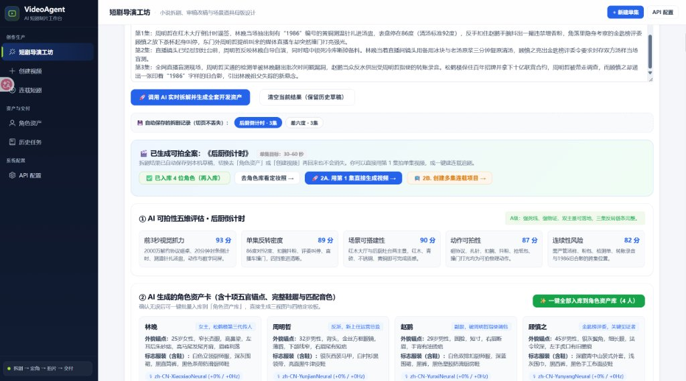
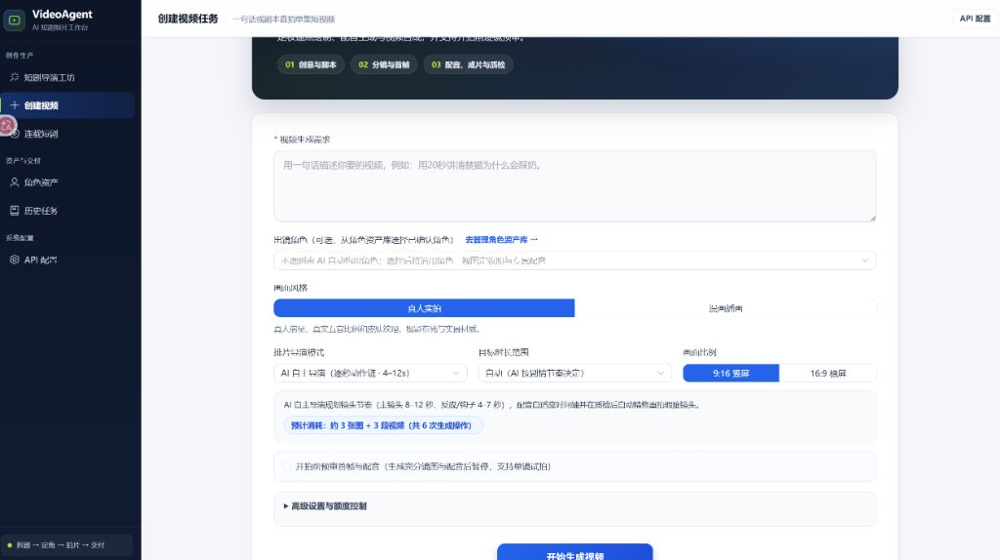
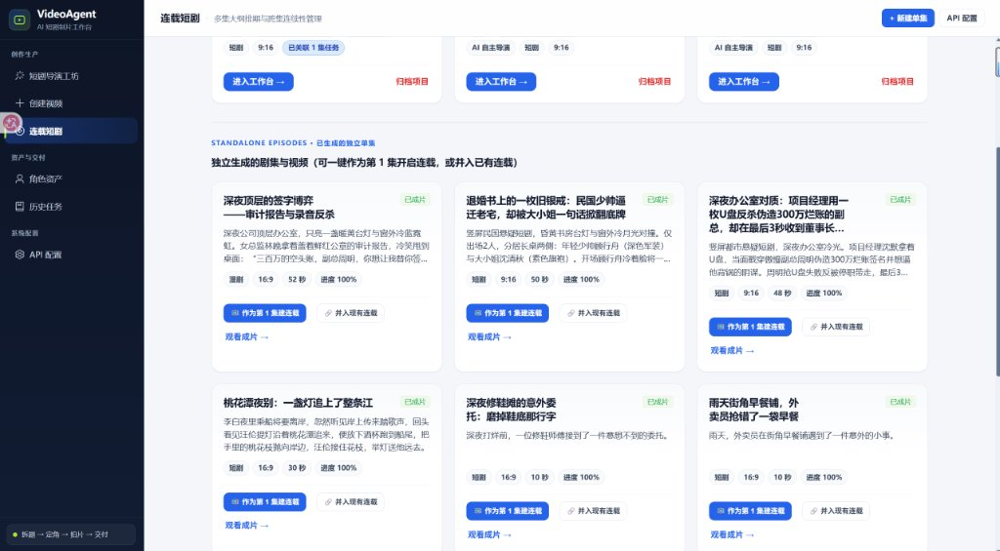
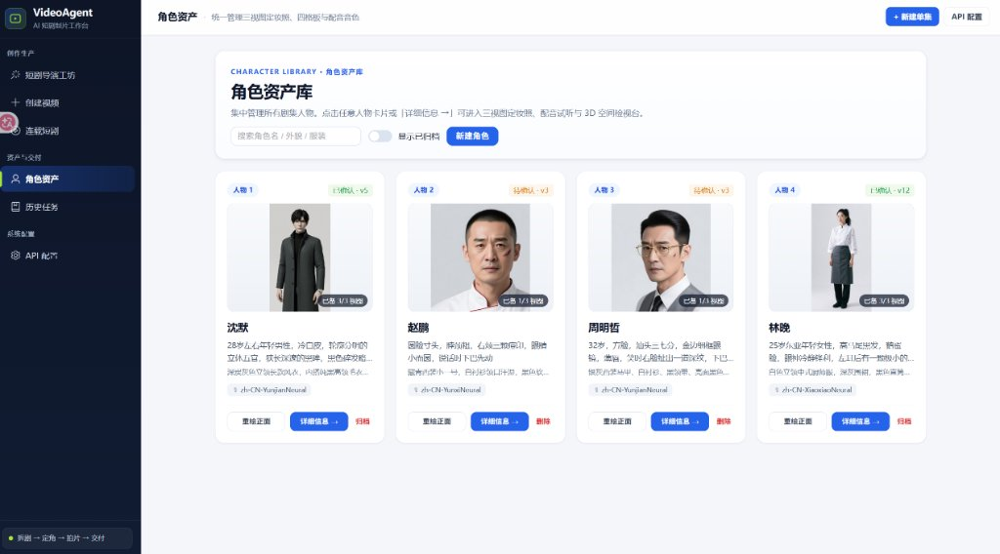
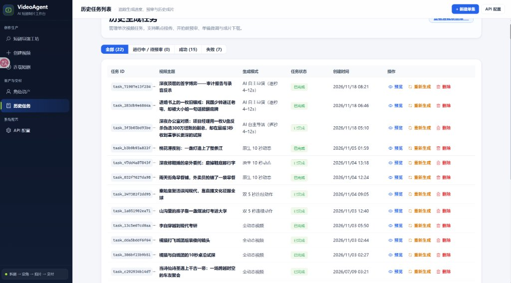
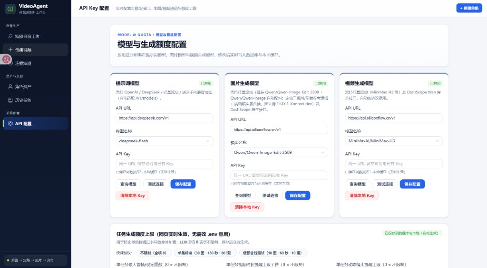

# VideoAgent · AI 短剧全流程制片工作台

VideoAgent 是一套面向 AI 短剧与漫剧创作的全流程制片工作台，打通 **「小说拆剧 → 角色定妆 → 单集/多集连载排片 → 首帧与配音预审 → 动态视频合成与质检交付」** 闭环。支持从长文小说、分场剧本或一句话创意出发，产出带角色一致性锚定、多角色情绪配音、精准时间轴字幕与背景配乐的完整短片（MP4 + SRT）。

---

## 核心功能与工作台界面

### 1. 短剧导演工坊（小说拆剧 · 审稿改稿 · 场景九宫格与道具四视图）



- **小说/创意一键拆剧（中/英文双市场模式）**：自动对输入文本进行 **AI 可拍性五维评估**（前 3 秒视觉抓力、单集反转密度、场景可搭建性、动作可拍性、连续性风险），并同步产出：
  - 含十项五官锚点、完整鞋履与匹配 TTS 音色的 **角色资产卡**（支持一键批量入库角色资产库）；
  - 按目标时长动态伸缩的 **第 1 集四挡节奏拍摄剧本** 与 **分集付费卡点大纲**；
  - 跨集追踪状态的 **四本连续性台账**（物理与战损服装、信息认知差、关键道具归属、恩怨关系弧线）。
- **AI 剧本审稿与去 AI 味深度重写**：自动扫描无效微动作、连续对白断档与文风套话，输出诊断处方并一键重写为可拍物理动作剧本。
- **场景 3×3 九宫格 & 关键道具 16:9 四格设定图 & 视频动作链安全升级**：一键生成标准美术资产提示词并可直接调用生图模型出图。
- **双路直通拍片**：拆解结果本机自动持久保存，可一键 **「2A. 用第 1 集直接生成视频」** 或 **「2B. 创建多集连载项目」**。

---

### 2. 创建视频任务（三大排片导演模式 · 弹性时长 · 开拍前预审）



- **三种排片导演模式**：
  - **AI 自主导演（逐秒动作链 · 4–12s）**：按剧情高潮弹性规划主镜头（8–12 秒）与反应/钩子镜头（4–7 秒），配音自适应时间轴，质检阶段支持问题镜头定向自愈重绘；
  - **剧组单元自由流（多镜交替 · 3–12s）**：自动先行并发绘制 16:9 四视图剧组角色设定板并自动裁切入库角色资产库，按景别与站位智能传入参考图锁脸，支持高潮镜头首尾双图锁终点与切镜闪白转场；
  - **原生 10 秒动态（10s 整切）**：以 10 秒整切单元快速生成标准叙事短片。
- **弹性时长区间与预审控制**：支持 `30–60 秒`、`45–90 秒`、`60–120 秒` 或自定义秒数区间；勾选 **「开拍前预审首帧与配音」** 后，流水线将在生成完首帧与配音时暂停，支持逐镜重绘首帧、生成尾帧或以轻量分辨率单镜试拍。

---

### 3. 连载短剧工作台（多集大纲排期 · 跨集状态延续 · 单集一键并入）



- **多集大纲与跨集连续性管理**：统一管理 3 / 5 / 10 集分集大纲（开场钩子、核心事件、结尾悬念）、锁定全季角色定妆版本，并维护跨集四本连续性台账，防止跨集服装复位、道具瞬移或角色未卜先知穿帮。
- **导演工坊全案自动同步**：在「短剧导演工坊」拆解的多集剧本进入本页时自动同步建剧，并自动识别已拍好的第 1 集任务直接并入。
- **独立单集一键转连载 / 并入现有剧集**：所有独立生成的单集视频均可直接作为第 1 集开启新连载，或并入任意现有连载的指定集数，自动提取结尾状态快照供后续集数衔接。

---

### 4. 角色资产库（三视图定妆照 · 四格定妆板自动裁切 · 专属配音音色）



- **三视图与四格定妆板统一管理**：集中管理所有剧集人物的外貌锚点（Face DNA）、标志服装（含鞋履约束）与多角度定妆照（正面、侧面、全身及 16:9 四格定妆板）。
- **剧组定妆板自动回填**：单集或工坊生成的 16:9 剧组角色设定卡会自动纵向裁切左一格正面立绘并同步至角色库（已有同名角色缺图自动补齐，新角色自动创建）。
- **版本确认与安全清理**：支持多版本回溯、定妆确认（锁定供连载剧集与单集引用）、配音试听、3D 空间检视台以及未绑定角色的永久删除。

---

### 5. 历史生成任务（进度追踪 · 断点续传 · 单镜精修与成片交付）



- **全周期任务管理**：按「全部 / 进行中·待预审 / 成功 / 失败」分类检索所有任务，支持随时进入 12 步流水线详情页查看剧本、分镜、首帧、配音、动态片段及实时生成额度消耗记录。
- **断点续传与单镜精修**：失败或中断的任务支持保留已有分镜、首帧与已生成视频片段原地续跑；已成片任务可在预览页单独微调某一段镜头的提示词、台词或配音并重新合成 MP4 与 SRT 字幕。

---

### 6. 模型与生成额度配置（三通道独立路由 · 网页端实时生效）



- **三通道独立配置，支持跨服务商混搭**：
  | 通道 | 负责的工作 | 支持的服务商与常用模型 |
  | --- | --- | --- |
  | **提示词模型** | 小说拆剧、审稿改稿、剧本、分镜与视觉提示词 | DeepSeek（`deepseek-chat` / `deepseek-flash`）、硅基流动（`deepseek-ai/DeepSeek-V3` / `Qwen/Qwen3-32B`）及任意 OpenAI 兼容接口 |
  | **图片生成模型** | 角色三视图、剧组四格定妆板、场景九宫格与分镜首尾帧 | 硅基流动（`Qwen/Qwen-Image-Edit-2509` + `Qwen/Qwen-Image` 自动配对、`black-forest-labs/FLUX.1-Kontext-dev`、`Kwai-Kolors/Kolors`）、DashScope（`wan2.7-image` / `qwen-image-plus`）及本地 ComfyUI |
  | **视频生成模型** | 首帧/首尾双帧图生动态视频片段 | 硅基流动（`MiniMaxAI/MiniMax-H3` 等）、DashScope（`wan2.6-i2v-flash` / `wan3.0-video`）、火山方舟（`doubao-seedance-1-5-pro`）、Vidu（`viduq3-turbo`）及本地 ComfyUI |
- **智能黑图/黑边自愈与跨模型时长自适应**：生图通道内置黑图、暗场黑洞与上下/左右黑边检测，异常时自动回退至满画幅文生图并增强布光重试；切换视频模型时自动按目标模型合法时长区间重平衡分镜时长。
- **网页端实时额度上限控制**：支持在页面直接设定「单任务最大首帧/设定图数、单任务视频时长上限、单任务动态镜头上限」（设为 `0` 表示不限制），以及单任务/整季连载的生成操作总上限，保存后同步写入数据库与本地缓存并立即生效。

---

## 12 步全自动制片流水线

```text
01 创意规划 (TaskPlannerAgent)
  → 02 剧本创作与审稿精修 (ScriptAgent + StoryJudgeAgent)
  → 03 分镜设计与剧透前置校验 (StoryboardAgent)
  → 04 台词动作化润色 (DialoguePolishAgent)
  → 05 站位轴线锁与视觉提示词 (PromptAgent)
  → 06 首帧/四格定妆板绘制 (ImageAgent) ∥ 07 多角色情绪配音合成 (VoiceAgent)
  → [可选：开拍前预审首帧与配音 / 单镜轻量试拍]
  → 08 动态镜头生成与质检自愈 (VideoAgent)
  → 09 字幕排布与竖屏防爆行 (SubtitleAgent)
  → 10 成片剪辑、色彩衔接与配乐拟音混音 (VideoEditorAgent)
  → 11 成片连续性质检 (QualityCheckAgent)
  → 12 成片与发布物料导出 (ExportAgent)
```

---

## 快速开始

### 1. 环境准备

- **Python**：3.12 或 3.13
- **Node.js**：20.19+ 或 22.12+
- **MongoDB**：本地或远程实例（默认连接 `mongodb://localhost:27017`，数据库名 `video_agent`）
- **FFmpeg**：用于音视频剪辑、响度标准化与尾帧提取（项目已内置 `imageio-ffmpeg` 回退支持）

### 2. 启动后端

在项目根目录打开终端：

```powershell
cd backend
python -m pip install -r requirements.txt
Copy-Item .env.example .env
python -m uvicorn main:app --host 127.0.0.1 --port 8000
```

> 使用云端大模型生成前，请确保 `backend/.env` 中已设置 `ENABLE_PAID_API=true`。可通过 `http://localhost:8000/health` 检查后端与数据库连接状态。

### 3. 启动前端

在另一个终端窗口执行：

```powershell
cd frontend
npm install
npm run dev
```

浏览器访问 [http://localhost:5173](http://localhost:5173)：
1. 先在左侧导航 **「API 配置」** 中填入提示词、图片和视频模型的 API URL、模型名称与 API Key（支持一键「查询模型」与「测试连接」）；
2. 前往 **「短剧导演工坊」** 拆解小说/剧本并一键将角色入库到 **「角色资产」**，或直接在 **「创建视频」** / **「连载短剧」** 开启拍片。

---

## 目录结构

| 目录 | 说明 |
| --- | --- |
| [backend/agents](backend/agents) | LangGraph 编排流水线及 12 步制片 Agent 实现 |
| [backend/services](backend/services) | 多服务商 LLM / 生图 / 视频模型适配、导演工坊、角色资产、连载管理与音视频合成服务 |
| [backend/routes](backend/routes) | FastAPI 路由（视频任务、连载短剧、角色资产、导演工坊、开拍预审、额度统计与系统配置） |
| [backend/tests](backend/tests) | 连续性、工作台增强、生成质量契约与回归测试套件 |
| [frontend/src](frontend/src) | Vue 3 + Vite + Element Plus 前端工作台界面 |
| [VideoAgent_项目设计](VideoAgent_项目设计) | 架构设计、界面规划与本地 ComfyUI 多模态接入方案 |

请妥善保管个人 API Key（本地密钥文件 `.env` 与 `.env.*.local` 已默认加入 `.gitignore` 忽略保护），并确保输入素材及导出成片具备相应使用权限。
