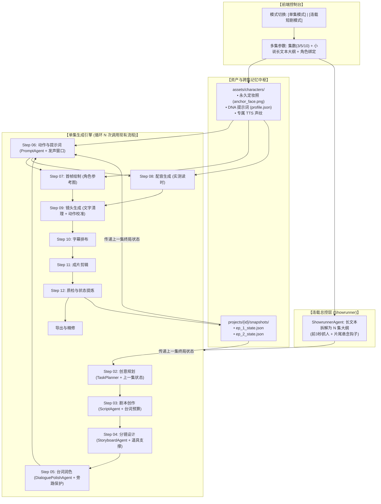

# VideoAgent 连载短剧功能设计方案（v4.1 评审稿）

> **文档定位**：本文描述拟新增的角色资产、连载调度、跨集状态和剧集工作台。方案尚未实施，模型参数与性能目标需在开发阶段确认。
> **核心目标**：在现有单集10秒分段流水线上，增加可复用角色、跨集剧情衔接和整剧管理能力。单集模式继续独立使用。
> **已有基础**：逐句配音时间调整、语速设置及复用视频重新合成已有实现，连载工作台应复用这些能力。

---

## 目录索引
1. [系统顶层拓扑架构与数据目录](#一-系统顶层拓扑架构与数据目录)
2. [角色一致性设计](#二-角色一致性设计)
3. [13 步端到端标准流水线（Step 00 ~ Step 12 详尽规约）](#三-13-步端到端标准流水线详尽规约)
4. [核心数据结构契约（JSON Schemas）](#四-核心数据结构契约json-schemas)
5. [高危踩坑点与避雷清单（必看）](#五-高危踩坑点与避雷清单必看)
6. [分阶段编码实施路线图](#六-分阶段编码实施路线图)
7. [剧集项目库](#七-历史记录升级从单条扁平任务到剧集项目库)
8. [发布与角色管理扩展](#八-发布素材与角色管理扩展可选)
9. [跨集依赖、版本与验收约定](#九-跨集依赖版本与验收约定)

---

## 一、 系统顶层拓扑架构与数据目录

### 1. 架构拓扑：总控调度器与单集循环引擎
系统采用**父子调度器模式（Parent-Child Orchestrator）**：外层总控负责“拆集与资产维护”，底层复用现有的单集 12 步生成流水线。



### 2. 标准工程目录规范
以下为逻辑归档示意。开发时沿用现有MongoDB任务与 `backend/assets/{task_id}`、`backend/outputs/{task_id}`，通过项目与单集索引关联素材；无需为增加连载功能迁移历史文件。

```text
VideoAgent/
├── assets/                          # 永久资产库（跨剧集全局复用）
│   └── characters/                  # 角色库
│       └── char_old_cobbler/        # 角色唯一标识
│           ├── anchor_face.png      # 角色永久定妆参考图（正脸+标志衣服）
│           └── char_profile.json    # 角色 DNA 描述、音色、服饰锁
├── projects/                        # 剧集产出工单
│   └── proj_cobbler_secret/         # 当前连续剧项目
│       ├── series_outline.json      # 总编剧拆出的 10 集大纲
│       ├── ep_01/                   # 第 1 集所有镜头、音频、字幕与成片
│       │   ├── render.mp4
│       │   ├── subtitle.srt
│       │   └── ep_01_state.json     # 第 1 集末尾终局状态快照
│       └── ep_02/                   # 第 2 集继承 ep_01_state.json
```

---

## 二、 角色一致性设计

通过固定角色描述、参考图和绑定音色提高跨镜头一致性。以下四类约束作为设计方向，实际表现由所选模型与生成结果验收确认。

角色身份与当前剧情状态分开保存。脸型、基准发型、稳定特征和音色属于角色身份；服装版本、污渍、伤痕、持物和位置属于单集状态。换衣、伪装或受伤由剧情显式记录，不能改写原始角色身份。多人镜头需要记录角色ID与参考图的对应关系。

### 1. 第一重：服装强锁定律（Costume Lock）
* **原理**：短视频观众在手机小屏幕上，对**衣服的颜色、款式、帽子**的敏锐度远高于细微的五官距离。
* **规则**：同一连续场景默认沿用服装。剧情需要更衣或伪装时创建服装状态版本，并传给后续镜头。
* **实操**：角色卡记录默认 `signature_clothing`，单集快照记录当前服装及状态。当前剧情状态优先于默认服装。

### 2. 第二重：不可变面部 DNA（Face DNA Lock）
* **特征标志物（Distinguishing Marks）**：在面部必须配置 1~2 个**模型极易识别且极具辨识度的锚点**：
  * 例：左下颌有一颗小黑痣（`small distinct mole on left jawline`）；
  * 例：右手中指贴有发黄胶布（`yellowed bandage wrapped around right middle finger`）。
* **防漂移**：当前镜头出现的角色注入其固定身份特征。局部特写或背影只描述可见部位，不能为了展示标志特征强行改变构图。

### 3. 第三重：首帧垫图锁相（Reference-to-Image / Cref API）
* 在 Step 06 生成每一集、每个镜头的首帧时：
  * **禁止纯文本生图**；
  * 内部记录角色ID与参考图绑定，由图片服务适配成所选模型实际支持的参数。
  * 参考权重仅在模型支持时提供，默认值通过开发阶段的样片确定，不统一写死为0.70。
  * 模型不支持参考图时，在开始连载前明确提示并让用户选择支持的模型，不能静默退回纯文本生图。
  * 定妆图由用户确认后锁定版本。创建连载前展示角色、音色和大纲供确认，确认后再批量生成。

### 4. 第四重：专属声纹锁（Voiceprint Binding）
* 角色卡内硬编码 Edge-TTS 的音色、语调偏移值（Pitch）与语速偏移值（Rate），杜绝后一集音色突变。

---

## 三、 13 步端到端标准流水线详尽规约

### 步骤 00：角色数字资产建档 (Asset Registration)
* **执行主体**：创作者预置 / 或系统调用生图模型一次性生成。
* **输入**：角色基本概念（例如：“55岁民国修鞋匠”）。
* **处理逻辑**：
  1. 调用生图模型生成一张高清、正脸、带有固定服装的定妆图 `anchor_face.png`；
  2. 提取并固化 `visual_dna`，选择固定 TTS 音色，保存为 `char_profile.json`。
* **输出**：`assets/characters/{char_id}/` 资产包。

---

### 步骤 01：连载大纲与短剧拆集 (Showrunner Breakdown)
* **执行主体**：`ShowrunnerAgent`（仅在多集启动时运行一次）。
* **输入**：小说长文本大纲、目标总集数（例如：3 集）、每集时长（如 30 秒）。
* **处理逻辑**：
  * 将长文本切分为 $N$ 个结构化单集事件；
  * **开场钩子**：前3秒给出符合题材的清晰事件、悬念或认知变化。
  * **单集收尾**：结尾给出本集的局面变化，并留下下一集要回答的问题。最后一集优先完成本季主线，续季钩子可选。
* **输出**：`series_outline.json`（见第四章规范）。

---

### 步骤 02：单集创意规划 (TaskPlanner)
* **执行主体**：`TaskPlanner`（进入单集循环）。
* **输入**：
  * 当前集大纲（来自 `series_outline.json`）；
  * **上一集终局状态快照（`prev_state_snapshot.json`，若第 1 集则为空）**。
* **处理逻辑**：
  * 存在上一集状态时，继承已经确认的人物、道具和因果事实；直接续接时继承空间与动作状态。
  * 剧情明确跳时或换场时允许重新建立首镜，并记录转换原因。
  * 按每集时长除以10确定核心节拍数，30秒为3段，60秒为6段。
* **输出**：每集时长除以10个分镜的剧情梗概、核心事件推进与起止状态定义。

---

### 步骤 03：剧本与台词创作 (ScriptAgent)
* **执行主体**：`ScriptAgent`。
* **输入**：第 02 步的分镜规划、角色列表。
* **处理逻辑与刚性公式**：
  * 角色必须标注明确注册 ID（如 `[CHAR_01: 老鞋匠]`）；
  * **字数刚性物理拦截公式**：
    $$\text{MaxWords} = \max\left(0, \lfloor (10 - voice\_start - 0.5) \times 3.5 \rfloor\right)$$
    （以10秒为例，从第2秒开口时，规划预算为26个汉字，预留0.5秒画面反应。该预算不能替代实际合成测速）。
  * 记录每句对白的计划段内起始时间 `start`。
* **输出**：包含 `dialogue_lines`（speaker, text, start）的三段剧本。

---

### 步骤 04：分镜视觉调度与物理落稳 (StoryboardAgent)
* **执行主体**：`StoryboardAgent`。
* **处理核心规则**：
  * **支撑面中转（Desk Staging）**：复杂交接优先借桌面等支撑面完成，写清放稳、松手与拾取的顺序。按事件需要安排在同段或相邻段，避免一次简单交接占用两个完整10秒段。
  * **机位与焦点转移**：说话时焦距给发声主体，严禁单镜头内 180° 反物理瞬间转身。
* **输出**：机位（Camera）、人物站位（Actor Position）、道具位置（Props）。

---

### 步骤 05：台词保护与原样透传 (DialoguePolishAgent)
* **执行主体**：`DialoguePolishAgent`。
* **避坑防崩规则**：
  * **旁路透传**：多人对白由于已经精确计算了字数与秒点，**大模型严禁修改字数**，直接原样透传！
  * 仅纯旁白允许调用大模型做口语化润色。

---

### 步骤 06：首帧提示词与逐秒动作生成 (PromptAgent)
* **执行主体**：`PromptAgent`。
* **输入**：分镜信息、`char_profile.json`、`dialogue_lines`、上一集状态。
* **核心规则**：
  * **首帧仅描述第0秒**：以start_state为准。若从取物开始，道具已放稳、接物者尚未接触；若放置发生在本段内，首帧保留原持物状态。
  * **注入不可变 DNA**：把角色的衣服、黑痣、发型强制拼入首帧描述；
  * **逐秒动作（1~10s）注入口唇开合动力学**：
    * 发声秒点：`“双唇自然轻微开合，下颌微动，面部肌肉微牵引，严禁夸张大张嘴”`；
    * 倾听/非说话秒点：`“双唇自然闭拢不语，下颌保持静止”`。
  * **全要素去文字化**：全面禁止写入“切黑、浮出文字、居中大字、字幕”。
* **输出**：沿用当前字段 `image_prompt`、`image_negative_prompt`、`video_prompt`、`video_negative_prompt`、`motion_beats` 和衔接说明，避免为新增连载功能更名已有字段。

---

### 步骤 07：首帧绘制（垫图锁脸） (ImageAgent)
* **执行主体**：生图接口（Qwen-Image / Midjourney / FLUX）。
* **处理逻辑**：
  * 读取第 06 步的首帧 Prompt；
  * 读取角色定妆照 `anchor_face.png` 作为 `reference_image`；
  * 调用生图 API，生成当前镜头的 0 秒起手图。
* **输出**：1080P 高清首帧图片 `scene_start_frame.png`。

---

### 步骤 08：配音合成与实测读时校准 (VoiceAgent)
* **执行主体**：`VoiceAgent` (Edge-TTS) + Python 时间校准网关。
* **处理逻辑**：
  1. 按角色专属音色合成音频，实测毫秒级真实时长 `actual_audio_duration`；
  2. **保序防崩算法**：若计划对白时间乱序，执行单调递增推挤：
    保留对白数组顺序，修正不递增的计划秒点。最小间隔随剩余空间调整，不能把最后一句推到镜头外；合成后再按真实读时检查重叠与总时长。
  3. **超长自适应变速**：若单句超出可用窗口，计算所需倍速：
     $$required\_speed = \max\left(1.0, \frac{actual\_audio\_duration}{available\_slot}\right)$$
     所需速度不超过1.25倍时可变速；超过时先尝试在当前段重排，仍无法容纳则缩句或告警，不自动截断台词。字数公式用于规划，实测读时用于最终排布。
* **输出**：合成好的音频切片、实测起止时间戳。

---

### 步骤 09：镜头动态生成与排毒过滤 (VideoAgent)
* **执行主体**：视频生成模型（Wan2.6 / 可灵 / 即梦 I2V）。
* **处理逻辑**：
  1. **正则双向排毒**：剔除“切黑出字、浮出字幕”等屏幕排版词，放行“鞋底刻有暗记、招牌刻字”等道具文字白名单；
  2. **实测配音与动作校准**：按具体分镜的reaction_focus确定观看重点。配音窗口与离场等动作冲突时，同步处理动作、构图、起止状态和尾帧说明；修改结束状态后更新跨镜头、跨集衔接。剧情保护人物反应，产品或科普保护实际演示目标。
  3. 以第 07 步的锁脸首帧为底，驱动生成 10 秒高清视频。
* **输出**：未烧录后期字幕的视频片段。是否存在模型生成的浮动文字需要检查原片，过滤规则不能保证所有生成结果都无文字。

---

### 步骤 10：字幕排布与时间轴对齐 (SubtitleAgent)
* **执行主体**：`SubtitleAgent`。
* **处理逻辑**：
  * 严格按第 08 步的**实测音频开始和结束时间**换算整片时间轴；
  * 生成标准 SRT 文件，字幕由后续剪辑步骤居中底部烧录，不交由视频大模型生成。
* **输出**：`subtitles.srt`。

---

### 步骤 11：成片剪辑与人机精修 (EditorAgent)
* **执行主体**：MoviePy / FFmpeg 渲染器与现有配音时间轴工作台。
* **处理逻辑**：
  1. 拼接各分镜视频，混入配音轨，烧录字幕，输出候选成片。
  2. 复用逐句音频起点与0.9x~1.25x语速调整能力，重新混音和生成字幕，使用未烧字幕的分镜素材。
  3. 耗时按实际片长与机器性能测量。移动音频不会同步改变已有口型与动作。
* **输出**：候选成片，进入第12步质检。

---

### 步骤 12：质检、状态提炼与导出 (QualityAgent + StateExtractor + ExportAgent)
* **执行主体**：QualityAgent、Python 提取程序与可选视觉模型。
* **处理逻辑**：
  * 先完成成片剪辑，再保留现有媒体完整性与时长检查。
  * 从本集最后一镜的实际末帧提取可观察状态，同时保留剧本计划状态。
  * 视觉观察注明来源帧与置信程度；没有视觉观察时标记为计划推断，不声称画面已执行。
  * 两者冲突时标记待确认。用户确认或满足自动发布规则后，发布带版本号的快照供下一集使用。
  * 发布单集成片与状态快照，更新剧集进度。下一集只引用已发布的快照版本。
* **输出**：成片MP4、SRT、封面与带版本的终局状态快照。

---

## 四、 核心数据结构示例

以下JSON用于说明字段与关联关系。开发时应补充正式校验模型，校验集数、角色引用、版本和状态。

### 1. 连载大纲结构：`series_outline.json`
```json
{
  "series_id": "series_cobbler_1942",
  "title": "暗夜修鞋铺",
  "total_episodes": 3,
  "characters_involved": ["char_old_cobbler", "char_officer_zhao"],
  "episodes": [
    {
      "episode_num": 1,
      "title": "军靴暗格",
      "opening_3s_hook": "特写：锋利柳叶刀猛然割开靴底内衬，指尖触碰到冰冷金属硬物",
      "core_event": "老鞋匠张伯在日军军官送修的马靴夹层中，发现一张带有蜡封的密电图纸",
      "cliffhanger_hook": "铺门外突兀响起沉重的军靴踩水踏步声，门板被重重砸响三下"
    },
    {
      "episode_num": 2,
      "title": "门内暗战",
      "opening_3s_hook": "老鞋匠以惊人速度将密电塞入桌下暗榫，反手抄起沾满鞋油的麻布",
      "core_event": "赵副官推门而入搜查可疑踪迹，目光数次扫过桌上冒着热气的茶碗",
      "cliffhanger_hook": "赵副官冷笑一声，拔出腰间配枪，枪口猛然指向老鞋匠眉心"
    },
    {
      "episode_num": 3,
      "title": "生死对峙",
      "opening_3s_hook": "张伯停住擦鞋的手，抬眼看向赵副官",
      "core_event": "张伯发现赵副官袖口藏着与密电相同的标记，两人确认彼此身份",
      "cliffhanger_hook": "铺外的脚步声停下，赵副官转头望向门口"
    }
  ]
}
```

### 2. 跨集因果状态快照：`ep_01_state.json`
```json
{
  "snapshot_id": "snapshot_ep01_v1",
  "revision": 1,
  "status": "draft",
  "source_kind": "planned",
  "source_task_id": "task_episode_01",
  "source_frame_path": null,
  "confidence": null,
  "episode_num": 1,
  "timestamp": "1942-winter-night",
  "handover_state": {
    "characters": {
      "char_old_cobbler": {
        "holding_item": "左手压着割开的马靴底，右手拿着生锈弯锥",
        "clothing_state": "深蓝马甲前襟溅有一点黑色鞋油污渍，右袖卷至肘部",
        "physical_condition": "右手中指包裹发黄胶布，额角挂着冷汗",
        "spatial_pose": "身体弓曲在木桌后，头部猛烈偏向左侧门板方向"
      }
    },
    "environment": {
      "workbench_props": "老榆木桌面上放着冒黑烟的煤油灯、平头锤、一碗冷掉的棒子面糊",
      "lighting": "暖黄钨丝/油灯侧逆光，铺子门缝透入冰冷的暮色蓝光"
    },
    "cliffhanger_context": "门板剧烈震动，门栓发出吱呀异响"
  }
}
```

---

## 五、 高危踩坑点与避雷清单（必看）

| 踩坑场景 | 错误做法（会导致什么翻车） | 正确做法（工业标准） |
| :--- | :--- | :--- |
| **角色服装** | 未记录服装变化可能影响角色识别。 | 连续场景沿用服装，更衣创建剧情状态版本，保留默认角色卡。 |
| **首帧生成** | 仅用文字维持人物，跨镜头可能漂移。 | 绑定已确认的角色参考图，按模型能力适配参数，参考权重通过样片确定。 |
| **道具交接** | 省略交接过程可能导致接触或位置错误。 | 优先借支撑面交接，写清接触、放稳、松手和拾取；按时长安排在同段或相邻段。 |
| **幽灵字幕** | 提示词写入“屏幕中间打出‘回家吃饭’四个字” $\to$ **画面被模型硬编码烧录怪异错字**。 | 提示词严禁写屏幕字卡；文字清理正则拦截后期排版词；真实字幕由剪辑层居中添加。 |
| **对白时序** | 按起始时间排序可能颠倒原对白顺序。 | 保留数组顺序，按剩余空间修正起点，按实测读时排布，超长时告警或缩句。 |
| **声画脱节** | 配音尚未结束，观看重点已转走。 | 用实测时间保护当前分镜指定目标，同步调整动作状态链与下一段依赖。 |
| **嘴型假人** | 动作仅写“老头说话” $\to$ **嘴唇死闭像腹语木偶**，或大张嘴导致**面部五官撕裂**。 | 精准约束：说话秒点“双唇节律轻微开合，下颌微动”；倾听秒点“闭拢静止”。 |

---

## 六、 分阶段编码实施路线图

为了保证系统开发的稳健性，不要一次性推翻所有代码，建议按照以下**四步渐进式演进**：

```text
【第一阶段：角色资产与参考图接入】
1. 创建带版本的角色卡，区分身份、默认服装与当前剧情状态。
2. 接入支持参考图的图片模型，处理多人参考图对应关系。
3. 提供定妆图和音色确认，选择角色后注入单集提示词。
验收目标：跨镜头的人物可辨认，失败时允许重绘并保留旧版本。

【第二阶段：连载项目与状态版本】
1. 新增连载项目和单集关联，沿用现有task_id与素材目录。
2. 保存计划状态、实际观察状态和已发布快照。
3. 记录每集使用的角色、大纲及上一集快照版本。
验收目标：可以追溯每集依赖，计划与观察冲突时进入待确认。

【第三阶段：拆集调度与断点恢复】
1. Showrunner输出N集大纲，用户确认后锁定大纲版本。
2. 调度器依次运行单集流程，检查成功状态后发布快照。
3. 支持失败重试、停止后续集调度及重生成后的依赖失效标记。
验收目标：失败不会继续下一集，重试复用已确认的任务和付费请求。

【第四阶段：剧集工作台与导出】
1. 增加连载创建、项目列表、单集详情和快照查看。
2. 复用现有逐句音频拖拽和语速调整，更新声音与字幕。
3. 提供ZIP打包与按集排序的整季合成，发布素材作为可选扩展。
验收目标：用户可以查看、精修、续跑和导出整剧，耗时按实测记录。
```


---

## 七、 历史记录升级：从单条扁平任务到【剧集项目库】

现在的 `History.vue` 是一个扁平任务表格（每生成 1 个视频占 1 行）。如果用户生成了一部 10 集短剧，表格里会被 10 个零散任务刷屏，完全看不出哪几集属于同一部剧，也无法追踪前后集因果。

必须将历史记录升级为**「父子两级工程架构」**，并可作为独立子页面扩展：

### 1. 历史页面视图层级（两级 Tab）
* **Tab 1: 连载短剧项目（Series Projects - 新增核心）**
  * 以“整部短剧”为卡片展示（如《暗夜修鞋铺》）；
  * 卡片显示：短剧封面、剧名、总集数、创建时间、当前进度（如 `已完成 3/3 集`、`生成中 4/10 集`）；
  * 提供快捷操作：`【进入剧集工作台】`、`【一键打包下载全部】`、`【删除整剧】`。
* **Tab 2: 单条实验任务（Single Tasks - 保留原有）**
  * 保留原有的单次 30 秒测试任务列表，方便调试单镜头。

---

### 2. 剧集详情工作台（SeriesDetail / 每一集内容可视化）
点击任意一部短剧卡片，进入专属的**剧集可视化工作台**：

```text
┌──────────────────────────────────────────────────────────────────────────────┐
│  项目名称：【暗夜修鞋铺】(民国/写实/竖屏9:16)  [一键导出整部ZIP] [一键拼接长视频]│
├──────────────────────────────────────────────────────────────────────────────┤
│  [第 1 集：军靴暗格] (30s) · 已完成                                           │
│  ├─ 黄金3秒: 锋利柳叶刀割开靴底内衬...                                        │
│  ├─ 终局悬念: 门外急促军靴踩水踏步声...                                      │
│  ├─ 视频预览: [▶ 播放视频]   [下载MP4]  [下载SRT]   [🎙️剪映时间轴微调]       │
│  └─ 因果状态: [查看继承与传递快照: 手持靴底、右手中指胶布...]                │
├──────────────────────────────────────────────────────────────────────────────┤
│  [第 2 集：门内暗战] (30s) · 已完成                                           │
│  ├─ 黄金3秒: 老鞋匠将密电塞入暗榫，反手拿鞋油布...                            │
│  ├─ 终局悬念: 赵副官拔出配枪，直指老鞋匠眉心...                              │
│  ├─ 视频预览: [▶ 播放视频]   [下载MP4]  [下载SRT]   [🎙️剪映时间轴微调]       │
│  └─ 操作按钮: [🔄 重新生成此单集 (不影响第1集)]                               │
├──────────────────────────────────────────────────────────────────────────────┤
│  [第 3 集：生死对峙] (30s) · ⚠️ 生成失败/中断                                  │
│  └─ 失败原因: 视频模型 API 响应超时。 [▶ 点击断点续跑 (继承第 2 集状态继续跑)] │
└──────────────────────────────────────────────────────────────────────────────┘
```

#### 关键交互能力：
1. **单集独立重抽（Re-roll Episode）**：
   * 创作者如果对“第 2 集”某个动作抽卡不满意，点击“重新生成第 2 集”。
   * 系统读取第1集已经发布的快照版本，创建第2集的新任务版本。旧成片在新版本发布前保留可用。
   * 若第2集发布的新快照改变了后续依赖，标记后续集“继承状态待确认”。用户可以逐集确认沿用，或从最早受影响集重新生成。
2. **断点续生成（Resume at Breakpoint）**：
   * 第6集失败时停止后续调度并显示失败原因。用户点击继续后，校验第5集已发布快照和第6集已完成素材，复用可用部分，恢复成功后才继续第7集。
   * 网络结果不明时先查询已提交的模型任务，避免重复提交付费请求。

---

## 八、 发布素材与角色管理扩展（可选）

以下扩展通过剧集工作台按需启用。默认发布素材使用通用模板，平台专用文案作为可选模板，不恢复创建页的平台必选项。

### 1. 发布文案（标题 + 正文 + 话题标签）
每集完成后可选生成发布素材，默认保存为 `publish_notes.txt`。选择平台专用模板时再使用对应措辞。标签与内容匹配，不把模型生成标签视为实时热门趋势。
* **吸睛主标题**：`第1集：老鞋匠深夜修靴，竟在鞋底摸出一把微型蜡封密电...`
* **悬念正文**：`原本以为只是个普通的军官马靴，割开内衬那一刻，我整个人后背发凉！门外突然传来的脚步声到底是谁？！关注看下集反转！`
* **爆款热门标签**：`#短剧 #反转 #民国悬疑 #一口气看完 #AI短剧`

### 2. 视频前 3 秒高光截帧（自动封面图生成）
* 从前几秒提取候选帧，提供选择与预览。FFmpeg负责截帧，选择高光需要额外评分逻辑或用户选择。
* 按实际画幅输出封面，可选叠加标题，并允许关闭标题。封面文字只用于封面文件。

### 3. 一键拼接整季长视频（Full-Length Movie Stitching）
* 抖音平台上除了发 1~2 分钟单集，最容易上热门的是**“大结局一口气看完超长版”**（例如 3 集连放的 90 秒长视频，或 10 集连放的 10 分钟合集）。
* 在剧集工作台顶部增加一个按钮：`【一键拼接全季长视频】`。
* 后端按集号拼接已发布成片。编码与音轨参数兼容时复用数据流，否则统一参数后转码，并显示处理进度。缺失或待确认的集数在导出前提示用户。

### 4. 专属【角色资产中心】（选角大厅）
在左侧导航栏加一个独立的 **【角色资产】** 页面：
* 可以预先创建并沉淀多个常驻角色（如：`老鞋匠`、`黑衣特务`、`女密探`）；
* 预览角色正脸定妆照、试听绑定的音色；
* 下次开新剧时，直接像剧组挑演员一样在下拉框打勾，实现角色跨剧集多番复用！

---

## 九、 跨集依赖、版本与验收约定

### 1. 项目、角色与单集关联

| 对象 | 关键设计字段 |
| --- | --- |
| 连载项目 | series_id、集数、每集时长、风格、比例、大纲版本、角色绑定、状态 |
| 角色版本 | character_id、revision、身份描述、默认服装、参考图、音色及rate/pitch |
| 单集版本 | series_id、episode_num、revision、task_id、outline_revision、角色版本引用、input_snapshot_id、output_snapshot_id |
| 状态快照 | snapshot_id、revision、来源任务与素材版本、计划状态、观察状态、用户修正、发布状态 |

同一剧集同一集号可以有多个生成版本，界面只把一个版本标为当前发布版本。角色卡修改不追溯覆盖已经生成的单集。

### 2. 快照发布规则

- 计划状态来自剧本和有效动作计划，观察状态来自实际末帧或视频观察，两者分别保存。
- 明确记录道具归属、左右手、服装状态、人物位置、尚未解决的事件，以及人物已经知道和仍不知道的信息。
- 用户修正的状态记录修改来源。无法确认的字段标为未知，不能自动补成已发生的事实。
- 首版默认在单集质检后由用户确认并发布快照。自动连续生成作为可选开关，开启前明确采用的自动发布条件。
- 自动模式只有在媒体检查通过、必需状态可确认且没有冲突时才能继续；缺少观察证据或存在冲突时进入待确认。
- 快照发布后保持不可变。修正生成新版本，并检查后续集对旧版本的依赖。

### 3. 调度、停止与重试

1. 用户确认角色和大纲后，创建单集任务并保存关联，再调用现有单集流水线。
2. 必须检查流水线返回的成功或失败状态，成功后才进行状态发布与下一集调度。
3. 同一集同一版本只能由一个调度执行者处理。重复点击继续应复用已有任务。
4. 网络中断后优先查询已受理的图片、视频任务状态。无法确定是否受理时进入待确认，避免重复计费。
5. 用户停止时停止派发后续工作，保留已完成素材。已提交的服务商任务是否可取消，按具体接口能力处理。
6. 失败只重试缺失或失效的阶段。更改剧情、角色版本或输入快照时创建新版本，不把旧缓存误用于新内容。

### 4. 重生成与后续集影响

重生成第N集时固定引用上一集已发布快照，并保留第N集旧版本。新版本发布后，比较后续实际依赖的剧情事实与状态字段。

- 只调整音量、字幕或音频起点，且不改变剧情内容与快照时，无需重生成后续集。
- 结尾事实、道具归属或角色状态改变时，将使用旧快照的后续集标记为“继承状态待确认”。
- 用户可逐集确认沿用，或从最早受影响集重新生成；未经确认不把旧后续集标成与新版本连续。
- 导出整季时明确列出所用的单集发布版本，提示缺集、失败集和待确认集。

### 5. 用户确认点与范围

首版包含角色资产、参考图适配、拆集大纲、顺序调度、版本快照、项目库、单集重生成与断点续跑。已有配音精修在剧集工作台复用。

发布文案、封面标题、ZIP打包和整季长视频可分批增加。自动发布到外部平台不属于本方案范围，导出文件由用户自行使用。

### 6. 验收与待验证项

| 功能 | 可检查的验收结果 |
| --- | --- |
| 角色一致性 | 当前镜头使用已确认的角色版本和参考图，用户能对不合格首帧重绘并比较版本 |
| 跨集衔接 | 下一集记录所用快照版本，人物认知、道具和服装状态有明确继承或转换原因 |
| 中断恢复 | 失败停止后续调度，继续时复用已经完成且仍有效的阶段与服务商任务 |
| 重生成 | 旧版本可回看，受影响的后续集可识别并由用户处理 |
| 精修与导出 | 音频与字幕使用同一时间轴，复用原始分镜视频，导出按集号及确认版本组织 |

参考图参数、多角色对应能力、人物一致性表现、精确口型需求、快照观察质量，以及重混和整季导出耗时，均在实现阶段按选定服务与实际机器测量后确定。口唇动作提示只约束大致发声状态，音节级同步需另外评估音频驱动或口型处理能力。

## 十、 开发进度（2026-11-06）

本节随实现更新。完成实现与通过真实模型生成验收分别记录。

- [x] 角色资产卡、版本、上传或生成定妆图、试听与绑定音色。
- [x] 支持参考图的 Qwen 图片型号适配，开拍前检查参考图能力。
- [x] 连载项目、分集大纲生成与编辑、大纲确认。
- [x] 逐集调度、停止后续派发、失败重试与已完成任务复用。
- [x] 计划快照、可用末帧展示、用户确认与发布版本。
- [x] 单集重生成、旧版本保留和后续继承待确认。
- [x] 角色资产页、连载列表和逐集工作台。
- [x] 从单集预览复用配音时间与语速精修。
- [x] 整季 ZIP 下载和本地视频合成入口。
- [x] 连载离线生命周期检查、参考图请求检查与模拟接口页面验证。
- [ ] 实际模型连载样片验收，包括多人同框、跨集人物一致性和发声表现。
- [x] 采样画面观察与基于可核对证据的自动发布。
- [x] 单集发布文案、可选话题模板与前3秒封面取帧。

### 当前支持范围

- 项目冻结所选角色版本。每镜根据可见角色ID选择参考图，配音按绑定角色使用对应音色、语速和音调。单集画面或剧情修改通过剧集工作台创建新版本。
- 默认生成一集后等待确认快照。配置视觉质检模型后，程序会采样最后一镜，分别保存计划状态、画面观察和采样时间。用户开启自动继续且结尾状态与悬念都能被采样帧验证时才自动发布。观察缺失、冲突或不明确时等待人工确认。
- 失败重试沿用原任务。重启后原服务商任务仍未到终态时，界面保留当前状态并阻止重复派发，避免同一集重复付费。
- 已确认的全部集数可导出。ZIP包含成片、可用字幕、发布素材与版本清单。整季合成复用本地成片并按实际画幅统一参数。
- 已发布单集可生成标题、正文和话题。封面支持前3秒清晰度选帧或指定时间、可选标题与JPG下载。
- 86项后端测试及前端构建通过。自动发布已用模拟观察验证，封面已用本地视频验证实际取帧和中文标题。真实视觉模型的状态判断和跨集人物一致性仍待样片验收。

### 本轮实施顺序

1. 角色子系统负责角色ID、不可变版本与参考图文件。接口统一返回现有ApiResponse格式。
2. 连载子系统通过series_id、episode_num、task_id和snapshot_id关联现有任务，分集顺序执行。
3. 单集引擎接收冻结的角色版本和上一集已发布快照，复用现有素材及配音精修。
4. 前端提供大纲确认、状态确认、继续、停止和单集重生成入口，导出前校验缺集和状态。

实现期间在当前工作区协作，不自动提交或推送。角色与连载子系统通过冻结JSON数据交接，避免跨模块修改同一文件。

## 十一、开拍前预审与制作工作台增强

### 1. 首帧、配音预审与单镜试拍

新增可选的开拍前预审。启用后，任务完成分镜提示词、首帧和配音才进入待开拍状态。进度页按镜头显示首帧、音频、动作时间点和台词窗口。用户可选择一个镜头试拍，或确认后生成整集。试拍只生成选中的镜头，完成后回到待开拍状态。

试拍与正式开拍共用镜头资产和生成签名。首帧、动作提示词、模型或画幅变化会触发该镜头重新生成。未变化的试拍结果在正式开拍时复用。单条任务和连载单集均可启用。未启用时继续按现有流程自动生成。

### 2. 调用额度与执行记录

创建前按时长展示预计首帧与视频生成数量。实际记录图片、视频的新请求、素材复用、成功和结果未确认。单条任务或连载项目可以设置累计新请求上限，项目下各集共用上限。无上限时只记账。

新生成操作在发出请求前原子预占额度。复用本地素材不占额度，状态未确认的请求仍计入额度。记录范围以系统发起的生成操作为单位，服务商内部重试和实际账单以服务商记录为准。达到上限时暂停进一步提交，保留已完成素材。调整上限后允许续跑。

### 3. 跨集依赖差异

每个待确认的单集展示它实际使用的上一集快照与当前发布快照。按字段列出旧值、新值和变更类型，明确关联的下一集。界面提供沿用和重生成操作。只比较状态字段，不用模型猜测具体镜头是否一定冲突。

### 4. 从质检问题跳到镜头

把画面问题的全片秒点映射到分镜和段内秒点。支持在进度页定位对应分镜、播放原片和查看实际提交的提示词。连载的画面或剧情改动仍走单集新版本，配音精修继续复用现有时间轴。

### 5. 多视角角色参考

角色版本可分别保存正脸、侧脸和全身参考。正脸是确认角色版本的基础，侧脸和全身是可选补充。根据分镜景别和拍摄侧选择每个可见角色的一张参考图。缺少适配视角时回退到该角色的正脸参考。修改任何参考图创建新角色版本，已绑定剧集继续使用冻结的旧版本。

### 实施进展追踪（全部已完成 ✅）

#### 1. 开拍前预审与单镜试拍
- [x] **后端核心逻辑（已完成）**：
  - `backend/models/task_model.py`：新增 `VideoTaskStatus.AWAITING_SHOOT_REVIEW` 状态，以及 `pre_shoot_review` 字段。
  - `backend/agents/pipeline.py`：新增 `shoot_review_node` 预审挂起节点与 `route_after_shoot_review` 分支，支持 `resume_shoot` 跳过前面环节直接进入视频生成。
  - `backend/agents/video_agent.py`：支持 `trial_scene_id` 单镜试拍，成功后不触发整体完成，失败不导致全任务失败。
  - `backend/services/video/wan_video_service.py`：增加 `has_pending_render` 与 `_render_paths` 用于镜头生成签名与防重复。
  - `backend/routes/shoot_review_routes.py`：新增单镜试拍 (`POST /{task_id}/shoot-review/trial`) 与批准正式开拍 (`POST /{task_id}/shoot-review/approve`) 路由。
  - `backend/services/series_service.py`：支持连载单集的 `approve_episode_shoot` 接入。
- [x] **路由挂载与前端工作台（已完成）**：
  - `backend/main.py` 已注册 `shoot_review_routes`。
  - 前端 `VideoCreateForm.vue` 与 `Series.vue` 已加入 `pre_shoot_review` 勾选开关与预计生成次数提示。
  - 前端 `TaskProgress.vue` 已展示开拍预审控制台横幅、单镜头试拍按钮、预审期重绘首帧/重录配音、试拍实时进度与确认开拍生成整集按钮。
  - 前端 `SeriesDetail.vue` 已提供连载单集的开拍预审提醒、分镜预审入口与确认本集开拍按钮。

#### 2. 调用额度与执行记录
- [x] **后端记账与分发（已完成）**：
  - `backend/services/generation_usage.py`：基于 MongoDB 的原子操作额度预占、扣减、复用记账、调用日志与超额异常 `GenerationLimitExceeded`。
  - `backend/services/generation_dispatch.py`：通用生成调度器，支持操作预占与异常捕获。
  - `backend/agents/image_agent.py`：图片生成已接入 `dispatch_generation` 与 `record_reuse`。
  - `backend/services/task_service.py` 与 `task_model.py`：支持传入 `generation_limit` 并在创建任务时初始化账本。
  - `backend/services/series_service.py`：支持连载剧集整季共享 `series:{series_id}` 额度账本。
  - `backend/routes/usage_routes.py`：新增 `GET /api/usage/{scope_type}/{scope_id}` 与 `PUT /api/usage/{scope_type}/{scope_id}` 接口。
  - `backend/tests/test_generation_usage.py`：并发原子预占与复用单测已编写。
  - `frontend/src/api/usage.js` 与 `frontend/src/components/GenerationUsage.vue`：额度卡片与执行日志组件已编写。
- [x] **全链路视频生图接入与前端挂载（已完成）**：
  - `backend/main.py` 已注册 `usage_routes`。
  - `backend/agents/video_agent.py` 与 `backend/routes/video_routes.py` 已完整接入 `dispatch_generation`、`record_reuse` 与 `has_pending_render` 续传免重复计费。
  - 前端 `GenerationUsage.vue` 组件已挂载到 `TaskProgress.vue`、`VideoPreview.vue` 与 `SeriesDetail.vue`。

#### 3. 跨集依赖差异
- [x] **差异计算与比对路由（已完成）**：
  - `backend/services/snapshot_diff.py`：递归比对状态快照字典 `compare_states`，生成 `added` / `removed` / `changed` 差异明细。
  - `backend/routes/series_routes.py`：新增 `GET /{series_id}/episodes/{episode_num}/dependency-diff` 接口。
- [x] **前端差异比对弹窗与快捷决策（已完成）**：
  - 前端 `frontend/src/api/series.js` 已封装 `dependencyDiff` 与 `approveShoot` 方法。
  - 前端 `frontend/src/views/SeriesDetail.vue` 已支持点击「查看前后集差异」弹窗对比旧快照与新快照的变更字段，并可直接在弹窗底部点击「沿用当前单集（接受更新）」或「按新状态重新生成本集」。

#### 4. 从质检问题跳到镜头
- [x] **质检时间戳映射与一键跳转精修（已完成）**：
  - `backend/agents/quality_agent.py`：新增 `locate_quality_issues` 与 `locate_semantic_issues`，将全片异常秒点自动映射到具体 `scene_id`、`scene_index` 与镜内秒点 `scene_offset`。
  - 前端 `TaskProgress.vue` 与 `VideoPreview.vue`：在质检告警处支持点击「定位并跳到该秒 / 定位精修」，自动高亮对应分镜、展开提示词详情并将成片及单镜播放器跳转到对应秒点。

#### 5. 多视角角色参考
- [x] **多视角存储、选图算法与前端展示（已完成）**：
  - `backend/models/character_model.py`、`character_service.py`、`character_routes.py` 与 `frontend/src/views/Characters.vue`：支持正脸 (`front`)、侧面 (`profile`)、全身 (`whole`) 三视角上传、预览与版本冻结。
  - `backend/services/character_binding.py`：`choose_reference`、`reference_choices_for_scene`、`reference_paths_for_scene` 算法及单测。
  - `backend/agents/image_agent.py` 与 `backend/routes/video_routes.py`：已切换为 `reference_choices_for_scene` 智能选择对应视角参考图，并将所选视角写入分镜 `reference_choices`，在 `TaskProgress.vue` 和 `VideoPreview.vue` 显示「参考图：正面/侧面/全身」标签。

#### 6. 前期排查出的遗留问题修复清单
- [x] `backend/services/publish_materials.py`：已补全 WSL `/mnt/c/Windows/Fonts/msyh.ttc`、`simhei.ttf` 及 Linux 字体回退路径，解决封面中文标题报错。
- [x] `frontend/src/views/Characters.vue`：已修复 `assetUrl` 自动剔除 `backend/` 前缀，角色三视图与试听音频正常加载。
- [x] `frontend/src/api/resourceClient.js`：已支持异步解析 `Blob` 错误响应中的 JSON `detail` / `message`，解决长视频合成 409 错误信息丢失问题。
- [x] `backend/routes/series_routes.py`：已新增 `_safe_unlink` 捕获 `OSError`，防止 Windows 下临时文件句柄未释放导致后台清理异常。

